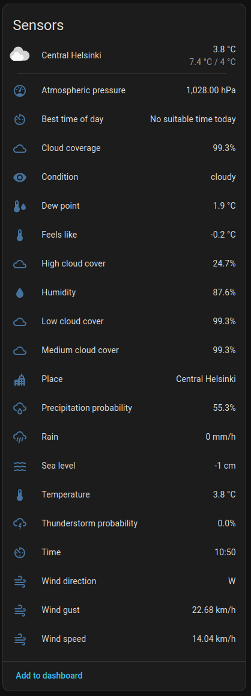
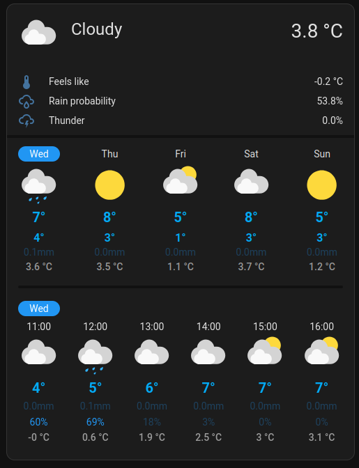

<!-- Copyright (c) 2026 kogeler. SPDX-License-Identifier: MIT. -->

# fmi-hass-custom

`fmi-hass-custom` is a maintained community custom integration for Home Assistant. It is developed
at [github.com/kogeler/fmi-hass-custom](https://github.com/kogeler/fmi-hass-custom) and uses
[Finnish Meteorological Institute (FMI) Open Data](https://en.ilmatieteenlaitos.fi/open-data)
to provide current conditions, hourly and daily forecasts, weather sensors, optional station
observations, lightning data, sea-level forecasts, and optional official weather warnings for a
configured location.

Check the [latest published GitHub Release](https://github.com/kogeler/fmi-hass-custom/releases/latest)
for the current integration version and its release notes. The minimum Home Assistant version is
declared in `hacs.json` for each release. Moving compatibility checks exercise the current stable
and prerelease channels as early warnings, but do not create a blanket support promise for future
releases.

**FMI Weather** is listed in the default catalog:

- **Home Assistant 2026.11 and newer:** open **Settings > Marketplace** and search for
  **FMI Weather**. The Marketplace is built into Home Assistant from 2026.11 and replaces HACS.
- **Older Home Assistant releases:** install [HACS](https://www.hacs.xyz/docs/use/), open it, and
  search for **FMI Weather**.
- **Either release:** use
  [this My Home Assistant link](https://my.home-assistant.io/redirect/hacs_repository/?owner=kogeler&repository=fmi-hass-custom&category=integration),
  which opens the repository in the Marketplace or in HACS, or copy the released integration
  manually.

See the [user guide](docs/USER_GUIDE.md#install-with-the-marketplace-or-hacs) for the full steps.

It is not bundled with Home Assistant Core and does not claim an official Core quality tier.

## Screenshots

  
  

The location's sensors (left) and its forecast in the optional
[Detailed Weather Forecast Card](docs/USER_GUIDE.md#more-detailed-weather-card-optional) (right),
which is maintained separately from this integration.

## Official Weather Warnings

Each location can also follow the official FMI weather warnings that cover its map point. They are
off by default:

1. Open **Settings > Devices & services > Finnish Meteorological Institute**, select the entry, and
   choose **Configure**.
2. Turn on **Enable official weather warnings** and choose the original message language: Finnish,
   Swedish, English, or Home Assistant's language.
3. Save. The location device gains a warning count sensor, a warning-level sensor, and a warning
   binary sensor.

A count of `0` with level `none` means that no active warning covers the location, which does not
mean the weather is safe; `unavailable` means the warning data could not be checked. The count
sensor carries the official message texts in its attributes. To show them on a dashboard, add the
Markdown card and the optional notification automation from
[the user guide](docs/USER_GUIDE.md#official-weather-warnings).

## Main Limitations

- Data depends on FMI and network availability. Polling cadence and source ownership are defined by
  [`RUN-002`](docs/contracts/RUNTIME.md) and the availability behavior by
  [the `AVL-*` assertions](docs/contracts/AVAILABILITY.md).
- The supported product geography is Finland. An FMI place search result outside Finland does not
  expand that boundary, and optional station or sea-level products can have narrower local
  coverage.
- The committed reference graph and the moving current-stable graph are continuously checked. The
  installation floor remains the value in `hacs.json` until a real integration incompatibility
  requires raising it.
- Changing Home Assistant's Home zone does not move an entry automatically. Use the integration's
  **Reconfigure** action to choose a new map point or search FMI by place name and confirm the
  result on the map.
- Lightning is opt-in. Its state reports locally calculated distance and direction from that FMI
  entry's configured point to a recent strike group; it does not predict storm movement or safety.
- Official weather warnings are opt-in and match the entry's coordinates against FMI warning
  polygons. Original text is available in Finnish, Swedish, or English; see
  [warning entities and dashboard examples](docs/USER_GUIDE.md#official-weather-warnings).
- Station observations require a valid FMI station ID. Sea-level and lightning sensors can be
  unavailable when an optional external source fails. A successful lightning response with no
  qualifying strikes remains available and says so explicitly.

## Documentation

### Users

- [Installation, configuration, upgrades, dashboards, and troubleshooting](docs/USER_GUIDE.md)
- [Current release and release notes](https://github.com/kogeler/fmi-hass-custom/releases/latest)
- [Release notes](CHANGELOG.md)
- [Known limitations and follow-up work](TODO.md)

### Maintainers

- [Normative contract catalog and automated traceability](docs/contracts/README.md)
- [Development environment and commands](docs/maintenance/DEVELOPMENT.md)
- [Dependency ownership and review](docs/maintenance/DEPENDENCIES.md)
- [CI and release gates](docs/maintenance/CI.md)
- [Home Assistant release maintenance](docs/maintenance/HA_RELEASE_MAINTENANCE.md)
- [HACS repository and release model](docs/maintenance/HACS_RELEASES.md)
- [Runtime change guide](docs/maintenance/RUNTIME.md)
- [Availability change guide](docs/maintenance/AVAILABILITY.md)
- [Optional-source change guide](docs/maintenance/OPTIONAL_SOURCES.md)
- [Weather-warning change guide](docs/maintenance/WARNINGS.md)
- [Live-test runbook](docs/maintenance/LIVE_TESTS.md)
- [Forecast-semantics change guide](docs/maintenance/FORECAST_SEMANTICS.md)
- [Time and missing-data change guide](docs/maintenance/TIME_AND_MISSING_DATA.md)
- [Sensor and supplement change guide](docs/maintenance/SENSORS.md)
- [Migration change guide](docs/maintenance/MIGRATIONS.md)
- [Reconfiguration change guide](docs/maintenance/RECONFIGURATION.md)
- [Compatibility, security, and privacy review](docs/maintenance/COMPATIBILITY_SECURITY.md)
- [License](LICENSE)

## Maintainer

[@kogeler](https://github.com/kogeler) maintains this fork. Report integration problems in the
[canonical repository issue tracker](https://github.com/kogeler/fmi-hass-custom/issues).

## Project History

This repository continues the work originally published by
[Anand Radhakrishnan](https://github.com/anand-p-r/fmi-hass-custom), retains its contributor
history, and preserves the original MIT attribution. Current maintenance and support belong to
this repository; the upstream project is not responsible for this fork.
